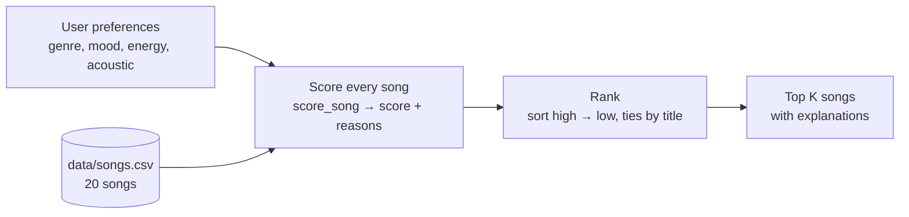

# 🎵 Music Recommender Simulation

## Project Summary

In this project you will build and explain a small music recommender system.

Your goal is to:

- Represent songs and a user "taste profile" as data
- Design a scoring rule that turns that data into recommendations
- Evaluate what your system gets right and wrong
- Reflect on how this mirrors real world AI recommenders

Replace this paragraph with your own summary of what your version does.

---

## How The System Works

Real platforms like Spotify and YouTube use hybrid filtering, which combines collaborative filtering (recommending what listeners with similar behavior enjoyed) with content-based filtering (recommending songs whose attributes resemble ones you already like). The **input data** is what the system knows about each song, such as its genre, mood, tempo, energy, and acousticness. The **user preferences** come from what a listener says and does: explicit signals like likes and playlist adds, and implicit signals like plays, skips, and replays. The **ranking** step scores every candidate song for how likely the listener is to enjoy it, sorts the list, and re-orders it for variety before showing the top results. VibeFinder is content-based only. It scores genre, mood, energy, and acousticness against one user's stated preferences. The tradeoff is that it can't learn from what a user actually plays or skips, and it can't discover cross-genre picks from other listeners' taste, so it only crosses genres when songs share attributes like energy.

### Features used in this simulation

**`Song`** (one row of `data/songs.csv`)

| Feature | Type | Used for scoring? |
|---|---|---|
| `genre` | text | Yes |
| `mood` | text | Yes |
| `energy` | 0.0–1.0 | Yes |
| `acousticness` | 0.0–1.0 | Yes |
| `tempo_bpm`, `valence`, `danceability` | numbers | Loaded, not scored yet |
| `id`, `title`, `artist` | labels | Shown in output only |

**`UserProfile`** (one listener's stated taste)

| Field | Example | Meaning |
|---|---|---|
| `favorite_genre` | `"pop"` | Genre the listener wants most |
| `favorite_mood` | `"happy"` | Mood the listener wants |
| `target_energy` | `0.8` | Energy level to get close to (not "the higher the better") |
| `likes_acoustic` | `False` | Whether acoustic songs should earn points or lose them |

### Algorithm recipe

`score_song` judges one song at a time and adds up points. Every point comes with a reason, so each recommendation can explain itself.

| Factor | Points | Rule |
|---|---|---|
| Genre | **+2.0** exact match, **+1.0** related | "Related" means one genre name contains the other, like "pop" and "indie pop". |
| Mood | **+1.0** | Exact match only. |
| Energy | up to **+1.5** | `1.5 × (1 − \|song energy − target energy\|)`. Closer earns more, so being 0.1 too high costs the same as being 0.1 too low. |
| Acoustic fit | up to **+0.5** | `0.5 × acousticness` if the user likes acoustic songs, `0.5 × (1 − acousticness)` if not. |

The best possible score is 5.0. A preference the user doesn't set adds no points.

### Data flow



### Biases I expect

- **Genre outweighs everything else.** A genre match (2.0) is worth twice a mood match and more than a perfect energy match. A pop song with the wrong mood can beat a song that matches the mood, the energy and the acoustic preference but isn't labeled pop.
- **Thin genres get a free pass.** 15 of the 17 genres have only one song, so that song earns the full +2.0 even when it fits the user's vibe badly.
- **Mood matching is literal.** "melancholy" doesn't count as "sad", and "euphoric" doesn't count as "happy".
- **Loud and electronic get counted twice.** Energy and acousticness still move together in this catalog (correlation −0.66), so a high-energy user who dislikes acoustic songs is rewarded twice for the same trait.

---

## Getting Started

### Setup

1. Create a virtual environment (optional but recommended):

   ```bash
   python -m venv .venv
   source .venv/bin/activate      # Mac or Linux
   .venv\Scripts\activate         # Windows

2. Install dependencies

```bash
pip install -r requirements.txt
```

3. Run the app:

```bash
python -m src.main
```

### Running Tests

Run the starter tests with:

```bash
pytest
```

You can add more tests in `tests/test_recommender.py`.

---

## Sample Recommendation Output

Paste a sample of your recommender's output here as a text block so a reader can see what it produces:

```
# e.g.:
# User profile: genre=indie, mood=chill, energy=low
# Recommendations:
#   1. ...
#   2. ...
#   3. ...
```

**Screenshot or video** *(optional)*: <!-- Insert a screenshot or demo video link here -->

---

## Experiments You Tried

Use this section to document the experiments you ran. For example:

- What happened when you changed the weight on genre from 2.0 to 0.5
- What happened when you added tempo or valence to the score
- How did your system behave for different types of users

---

## Limitations and Risks

Summarize some limitations of your recommender.

Examples:

- It only works on a tiny catalog
- It does not understand lyrics or language
- It might over favor one genre or mood

You will go deeper on this in your model card.

---

## Reflection

Read and complete `model_card.md`:

[**Model Card**](model_card.md)

Write 1 to 2 paragraphs here about what you learned:

- about how recommenders turn data into predictions
- about where bias or unfairness could show up in systems like this


